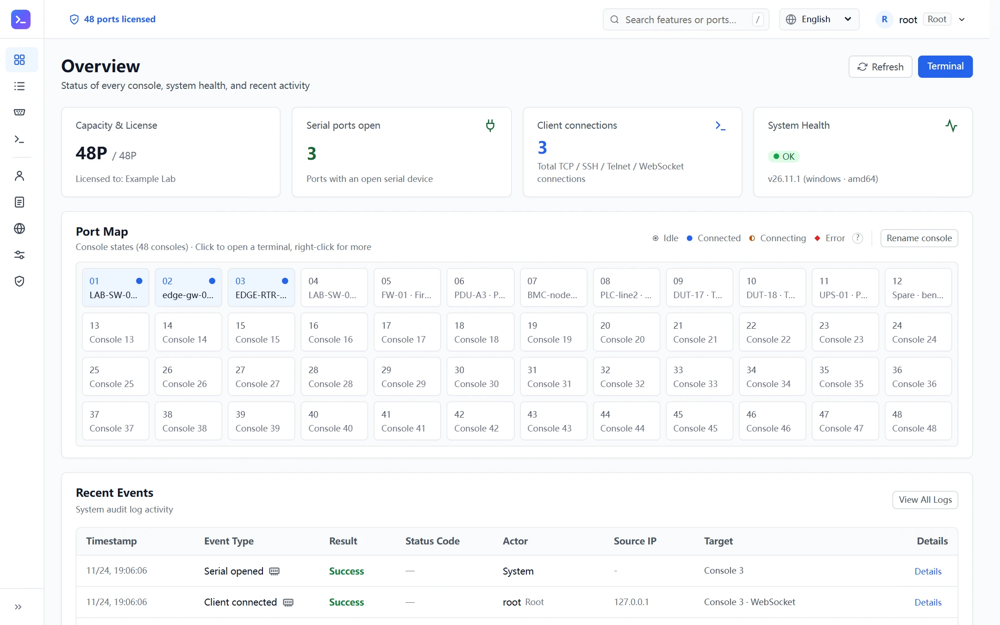

# Betterone Console Server

**Remote serial consoles, no dedicated hardware.** Run Betterone Console Server on a Windows PC, a Linux host or a Raspberry Pi with USB serial adapters, and reach your serial devices from a browser, SSH, Telnet or Raw TCP.

[中文说明](README.zh-CN.md) · [Website](https://cs.betterone.top) · [Download](https://github.com/betteronetop/console-server-public/releases) · [User guide](https://cs.betterone.top/manual) · [Pricing](https://cs.betterone.top/buy)

This repository holds the releases, the issue tracker and public notes. The source code is not published here.

## What it does

- **Web interface**: name each console, bind it to a serial port, set the line parameters, and see who is connected.
- **Web terminal**: open a console in the browser, one tab per device, with nothing to install.
- **A port per console**: every console has its own SSH, Telnet and Raw TCP port.
- **Management CLI over SSH** (port 2222): everything in the web interface is also a command, with Tab completion, `?` for help and plain-text output with exit codes for scripts.
- **REST API**: API keys limited to the consoles they need; the OpenAPI reference is built in at `/api/docs` and works offline.
- **Users and audit**: roles, per-console access, SSH keys, and an audit log of sign-ins, connections and changes.

## Download

Get the packages from [Releases](https://github.com/betteronetop/console-server-public/releases).

| System | Package |
| --- | --- |
| Windows x64 | `bcs_<version>_win-x64-setup.exe` (Windows service installer) or `bcs_<version>_win-x64.zip` (portable) |
| Linux x86_64 | `.deb` / `.rpm` (systemd service) or `bcs_<version>_linux-x64.tar.gz` (portable) |
| Linux ARM64 (64-bit Raspberry Pi OS) | `.deb` / `.rpm` or `bcs_<version>_linux-arm64.tar.gz` |
| Linux ARMv7 (32-bit Raspberry Pi OS) | `.deb` / `.rpm` or `bcs_<version>_linux-armv7.tar.gz` |
| Buildroot / BusyBox | `bcs_<version>_buildroot-arm64.tar.gz`, `bcs_<version>_buildroot-armv7.tar.gz` (root file system overlays) |

`checksums.txt` lists the SHA-256 of every file. License activation has been verified on Windows x64, Linux amd64 and Raspberry Pi 5; other systems, virtual machines and containers are not guaranteed.

## Getting started

1. Install the package for your system. The Windows installer and the Linux packages register a system service and start it.
2. Open `http://<server IPv4>/` in a browser.
3. Sign in as `root` with the initial password `admin123`. You are asked to set a new password and accept the license agreement at once. Do this on a trusted network, or set the password on the machine itself with `betterone-cs --init-admin`.
4. Bind a console to a serial port and open it in the web terminal, or connect with `ssh -p 6001 root@<server IPv4>` for console 1.

The [user guide](https://cs.betterone.top/manual) covers installation, binding, protocols, licensing and troubleshooting.

## Editions

| | Community (free) | Commercial |
| --- | --- | --- |
| Consoles | 1–4 | 8, 16 or 48, per license |
| Web interface, web terminal, SSH / Telnet / TCP, management CLI, audit log | Yes | Yes |
| Accounts other than `root`, API keys, source access rules | No | Yes |

The community edition needs no activation. A license takes effect at once, without reinstalling. See [pricing](https://cs.betterone.top/buy).

## Reporting a problem

Open an [issue](https://github.com/betteronetop/console-server-public/issues/new/choose) with the version (`betterone-cs --version`), the system, the serial adapter and the steps to reproduce. Remove passwords, keys, activation codes and anything else private from logs before posting.

Security problems: do not open a public issue; see [SECURITY.md](SECURITY.md).

Questions about purchases or licenses: [support@betterone.top](mailto:support@betterone.top).

## License

Betterone Console Server is proprietary software. See [LICENSE.md](LICENSE.md).
