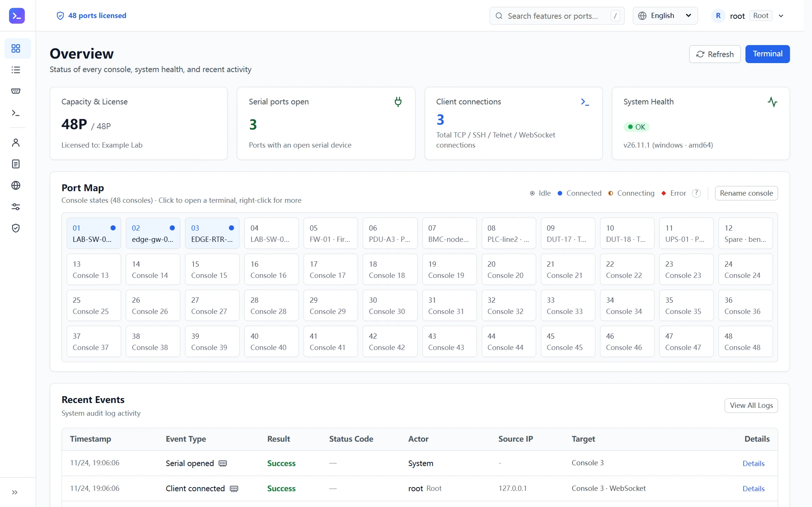

# Betterone Console Server

**远程管理串口设备，无需专用硬件。** 把 Betterone Console Server 装在 Windows 电脑、Linux 主机或树莓派上，接上 USB 串口适配器，就能通过浏览器、SSH、Telnet 或 Raw TCP 远程访问串口设备。

[English](README.md) · [官网](https://cs.betterone.top/zh) · [下载](https://github.com/betteronetop/console-server-public/releases) · [使用指南](https://cs.betterone.top/zh/manual) · [授权与价格](https://cs.betterone.top/zh/buy)

本仓库用于发布安装包、收集问题反馈和公开说明，不包含源代码。

## 能做什么

- **网页管理界面**：给每个控制台命名、绑定串口、设置串口参数，查看谁在连接。
- **在线终端**：在浏览器里直接打开控制台，每台设备一个标签页，不用装任何软件。
- **每个控制台一个端口**：每个控制台都有独立的 SSH、Telnet 和 Raw TCP 端口。
- **SSH 管理命令行**（2222 端口）：网页上能做的事都有对应命令，支持 Tab 补全、`?` 提示，给脚本用时返回纯文本和退出码。
- **REST API**：API Key 可以只授权所需的控制台；OpenAPI 文档内置在 `/api/docs`，不联网也能看。
- **用户与审计**：角色、按控制台分配权限、SSH 密钥，登录、连接和修改都记在审计日志里。

## 下载

从 [Releases](https://github.com/betteronetop/console-server-public/releases) 下载安装包。

| 系统 | 安装包 |
| --- | --- |
| Windows x64 | `bcs_<版本>_win-x64-setup.exe`（Windows 服务安装包）或 `bcs_<版本>_win-x64.zip`（绿色版） |
| Linux x86_64 | `.deb` / `.rpm`（systemd 服务）或 `bcs_<版本>_linux-x64.tar.gz`（绿色版） |
| Linux ARM64（64 位树莓派系统） | `.deb` / `.rpm` 或 `bcs_<版本>_linux-arm64.tar.gz` |
| Linux ARMv7（32 位树莓派系统） | `.deb` / `.rpm` 或 `bcs_<版本>_linux-armv7.tar.gz` |
| Buildroot / BusyBox | `bcs_<版本>_buildroot-arm64.tar.gz`、`bcs_<版本>_buildroot-armv7.tar.gz`（根文件系统覆盖包） |

`checksums.txt` 列出了每个文件的 SHA-256。授权激活已在 Windows x64、Linux amd64 和树莓派 5 上验证；其他系统、虚拟机和容器不作保证。

## 快速开始

1. 安装对应系统的安装包。Windows 安装包和 Linux 软件包会注册并启动系统服务。
2. 在浏览器里打开 `http://<服务器 IPv4>/`。
3. 用 `root` 和初始密码 `admin123` 登录，系统会立即要求设置新密码并接受许可协议。请在可信网络中完成；也可以在本机用 `betterone-cs --init-admin` 设置密码。
4. 给控制台绑定串口，然后在在线终端里打开；或者用 `ssh -p 6001 root@<服务器 IPv4>` 连接控制台 1。

安装、绑定、协议、授权和故障排查见[使用指南](https://cs.betterone.top/zh/manual)。

## 版本

| | 社区版（免费） | 商业版 |
| --- | --- | --- |
| 控制台数量 | 1–4 | 按授权 8、16 或 48 个 |
| 网页界面、在线终端、SSH / Telnet / TCP、管理命令行、审计日志 | 有 | 有 |
| root 以外的账号、API Key、来源访问控制 | 无 | 有 |

社区版无需激活。授权激活后立即生效，无需重装。详见[授权与价格](https://cs.betterone.top/zh/buy)。

## 反馈问题

请提交 [Issue](https://github.com/betteronetop/console-server-public/issues/new/choose)，写明版本号（`betterone-cs --version` 的输出）、系统、串口适配器型号和复现步骤。贴日志前请删掉密码、密钥、激活码等私密信息。

安全问题请不要公开提交 Issue，见 [SECURITY.md](SECURITY.md)。

购买和授权相关的问题请发邮件到 [support@betterone.top](mailto:support@betterone.top)。

## 许可

Betterone Console Server 是闭源商业软件，见 [LICENSE.md](LICENSE.md)。
